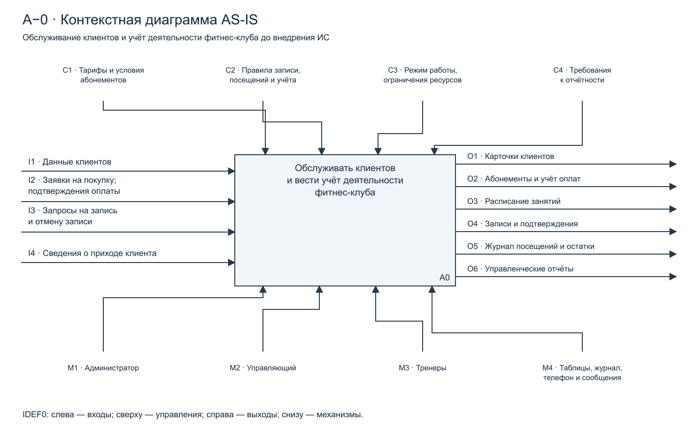
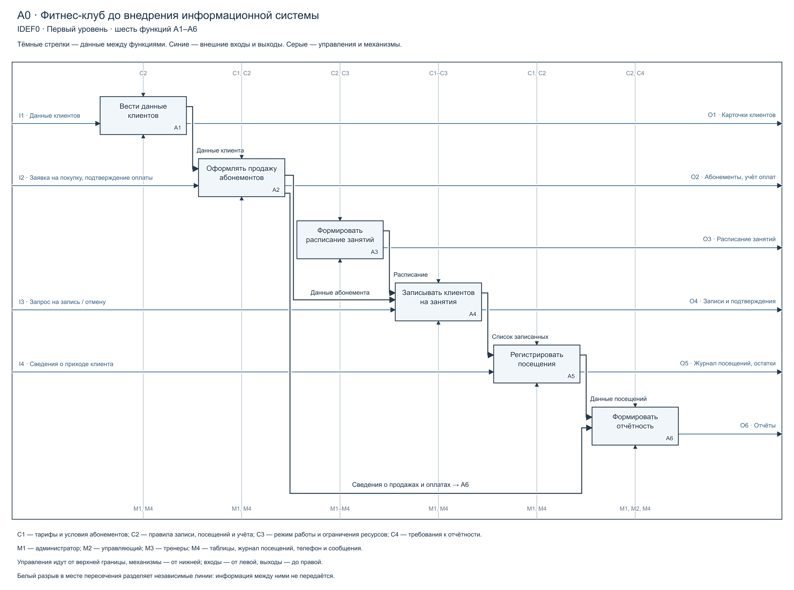
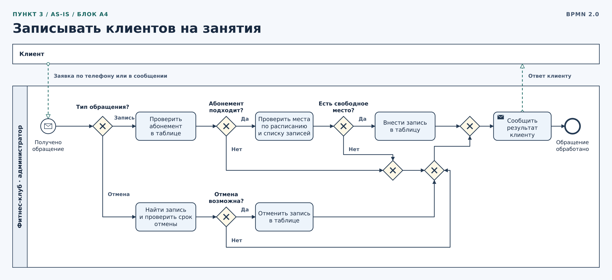
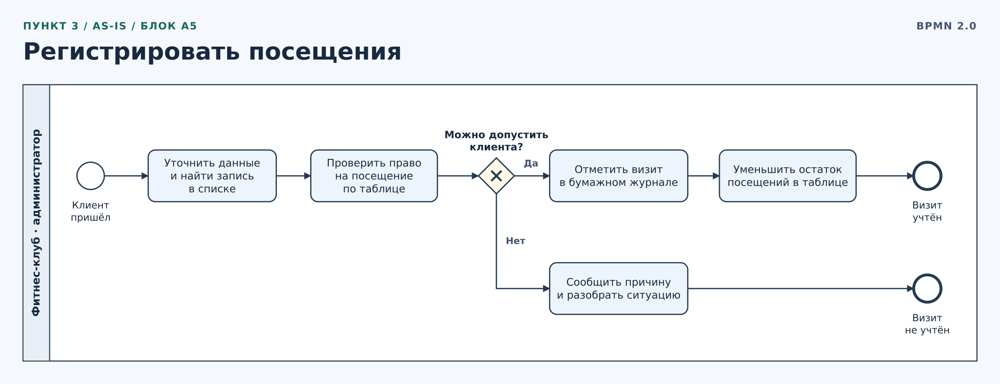
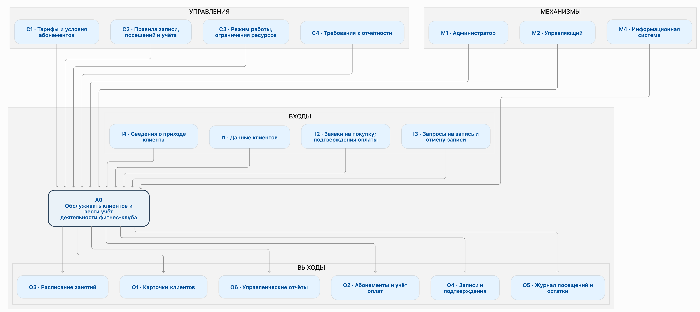
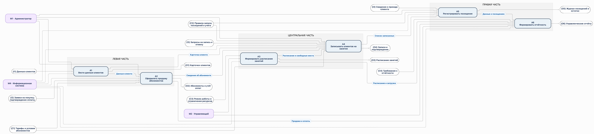
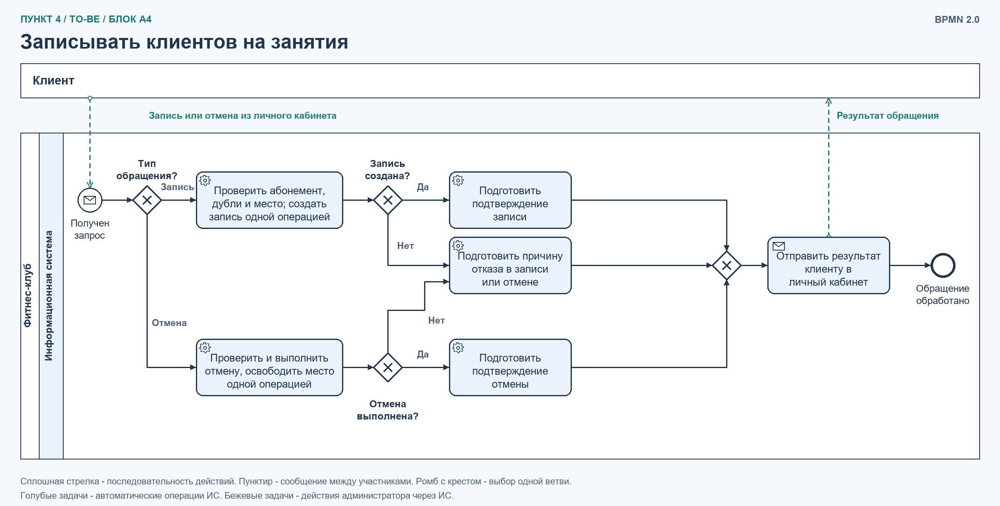
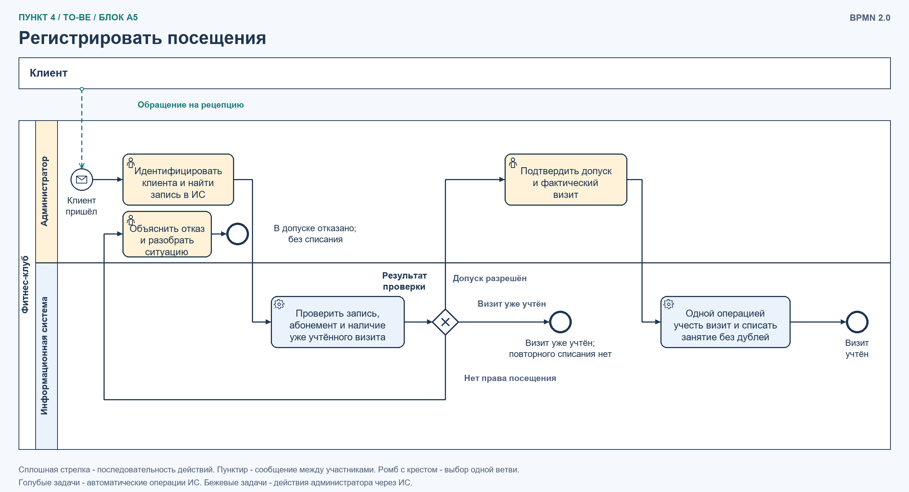

# Модель бизнес-процессов фитнес-клуба до внедрения информационной системы

## 1. Контекстная диаграмма IDEF0

Цель модели — описать обслуживание клиентов и учёт деятельности фитнес-клуба в текущем состоянии (AS-IS). Модель рассматривается с позиции управляющего клуба. Границы охватывают ведение клиентских данных, продажу абонементов, составление расписания, запись на занятия, регистрацию посещений и отчётность. Проведение тренировок, кадровый и бухгалтерский учёт в модели подробно не раскрываются.

До внедрения предлагаемой ИС сотрудники используют электронные таблицы, бумажный журнал посещений, телефон и сообщения. Автоматическая веб-запись и единая база данных отсутствуют.

Рисунок 1 — Контекстная диаграмма A-0 «Обслуживать клиентов и вести учёт деятельности фитнес-клуба», AS-IS.

На контекстной диаграмме представлена одна функция A0. Входы поступают слева, управления — сверху, выходы показаны справа, механизмы — снизу.

| Вид стрелки | Код | Содержание |
|---|---|---|
| Вход | I1 | Данные клиентов: ФИО, контакты и сведения для идентификации |
| Вход | I2 | Заявки на покупку абонементов и подтверждения оплаты: кассовые и банковские документы |
| Вход | I3 | Обращения клиентов для записи на занятие и отмены записи |
| Вход | I4 | Сведения о фактическом приходе клиента |
| Управление | C1 | Тарифы, сроки действия и условия использования абонементов |
| Управление | C2 | Правила записи, отмены, посещения, списания занятий и ведения учёта |
| Управление | C3 | Режим работы клуба, доступность тренеров и залов, ограничения вместимости |
| Управление | C4 | Требования управляющего к составу и периодичности отчётности |
| Выход | O1 | Созданные или актуализированные карточки клиентов в таблицах |
| Выход | O2 | Оформленные абонементы и записи об оплатах |
| Выход | O3 | Составленное расписание занятий |
| Выход | O4 | Записи на занятия и сообщения клиентам о результате обращения |
| Выход | O5 | Отметки в журнале посещений и обновлённые остатки занятий |
| Выход | O6 | Управленческие отчёты по оплатам и посещениям |
| Механизм | M1 | Администратор |
| Механизм | M2 | Управляющий |
| Механизм | M3 | Тренеры, участвующие в согласовании расписания |
| Механизм | M4 | Электронные таблицы, бумажный журнал, телефон и сообщения |

Управления задают условия выполнения работы, а механизмы обозначают исполнителей и используемые средства. Например, тариф определяет условия продажи, а администратор выполняет продажу. Составленное расписание является результатом работы A3 и используется функцией A4 при обработке запросов на запись.

## 2. Декомпозиция первого уровня IDEF0

Функция A0 раскрыта шестью блоками A1–A6, что соответствует требованию использовать не менее пяти блоков. Диаграмма отражает функциональные зависимости; расположение блоков не означает, что при каждом обращении клиента обязательно выполняются все шесть функций.

Рисунок 2 — Диаграмма A0: декомпозиция обслуживания клиентов и учёта деятельности фитнес-клуба, AS-IS.

| Блок | Содержание функции | Основной результат |
|---|---|---|
| A1. Вести данные клиентов | Администратор принимает данные клиента, ищет существующую карточку и вручную создаёт или обновляет запись в таблице | Актуальные данные клиента |
| A2. Оформлять продажу абонементов | Администратор обрабатывает заявку, выбирает тариф, проверяет подтверждение оплаты и заносит срок действия и число посещений в таблицу | Оформленный абонемент и учтённая оплата |
| A3. Формировать расписание занятий | Управляющий или администратор согласовывает доступность тренеров и залов, учитывает режим работы и вместимость, составляет расписание в таблице | Расписание занятий |
| A4. Записывать клиентов на занятия | Администратор принимает обращение по телефону или через сообщения, проверяет абонемент и свободные места, вносит или отменяет запись, сообщает результат клиенту | Актуальные записи, подтверждения или сообщения об отказе |
| A5. Регистрировать посещения | При приходе клиента администратор находит запись, сверяет право посещения, ставит отметку в журнале и вручную обновляет остаток занятий | Учтённое посещение и актуальный остаток |
| A6. Формировать отчётность | Администратор или управляющий сводит сведения о продажах, оплатах и посещениях из таблиц и журнала | Управленческие отчёты |

### Связи между функциями

- A1 → A2: сведения о клиенте используются для оформления абонемента.
- A2 → A4: сведения об абонементе позволяют проверить срок действия и остаток посещений перед записью.
- A3 → A4: расписание определяет доступные занятия; количество свободных мест администратор проверяет по существующим записям.
- A4 → A5: список записанных используется при регистрации пришедших клиентов. Запись содержит ссылку на клиента и его абонемент.
- A2 → A6: сведения о продажах и оплатах используются в отчётности.
- A5 → A6: сведения о посещениях используются в отчётах о посещаемости.

### Управления и механизмы на первом уровне

ДУ каждого блока сверху указаны применимые управления — правила и ограничения, а снизу — механизмы: исполнители и используемые средства. Для наглядности внешние стрелки показаны короткими отрезками. Обозначения I1–I4, O1–O6, C1–C4 и M1–M4 соответствуют контекстной диаграмме. Стрелки между блоками показывают передачу данных между функциями.

Граничные входы I1–I4 и выходы O1–O6 соответствуют контекстной диаграмме. Внутренние стрелки раскрывают обмен данными между функциями без изменения общей границы модели.

### Краткое пояснение к модели AS-IS

В текущем состоянии основные проверки и перенос данных выполняются вручную. При записи администратор обращается к данным абонемента и расписанию, самостоятельно определяет наличие свободных мест и отправляет подтверждение отдельным сообщением. При посещении отметка в бумажном журнале и изменение остатка занятий в таблице являются отдельными действиями. Для отчётности сведения из разных источников сводятся вручную. Это создаёт предпосылки для ошибок записи и списания посещений, а также увеличивает время обслуживания и подготовки отчётов.

# 3. Декомпозиция второго уровня до внедрения информационной системы

Для модели AS-IS фитнес-клуба в нотации BPMN раскрыты блоки A4 и A5 диаграммы первого уровня. Обе схемы описывают ручную работу администратора до внедрения информационной системы.

## 3.1 Блок A4 «Записывать клиентов на занятия»

*Рисунок 3 — Декомпозиция блока A4 «Записывать клиентов на занятия», AS-IS.*

Клиент обращается к администратору по телефону или в сообщении. При записи администратор проверяет срок действия и остаток посещений по абонементу, затем сверяет расписание и вручную проверяет наличие места по списку записанных. Если условия выполнены, он вносит запись в таблицу. При запросе на отмену администратор находит запись и проверяет, можно ли отменить её до начала занятия. После любого из этих сценариев клиент получает подтверждение или причину отказа. Актуальный список записанных используется в блоке A5.

## 3.2 Блок A5 «Регистрировать посещения»

*Рисунок 4 — Декомпозиция блока A5 «Регистрировать посещения», AS-IS.*

После прихода клиента администратор находит его в списке записанных и по таблице проверяет право на посещение. Если допуск подтверждён, он отмечает визит в бумажном журнале и отдельно уменьшает остаток посещений в таблице. Если право на посещение не подтверждается, администратор объясняет причину и разбирает ситуацию. Сведения об учтённых визитах используются в блоке A6 для отчётности.

## 4. Модель TO-BE: процессы после внедрения информационной системы

Для описания состояния фитнес-клуба после внедрения информационной системы (модель TO-BE) построены контекстная диаграмма и её декомпозиция первого уровня. Модель сохраняет преемственность с AS-IS, но отражает изменения, связанные с автоматизацией учёта, контроля и взаимодействия с клиентами.

*Рисунок 5 — Контекстная диаграмма A-0 «Обслуживать клиентов и вести учёт деятельности фитнес-клуба с использованием ИС», TO-BE.*

*Рисунок 6 — Диаграмма A0: декомпозиция обслуживания клиентов и учёта деятельности фитнес-клуба с использованием ИС, TO-BE.*

### 4.1. Второй уровень TO-BE. Блок A4 «Записывать клиентов на занятия»

На втором уровне раскрыта обработка запросов на запись и отмену записи после внедрения ИС. Использована нотация BPMN 2.0.

*Рисунок 7 - Декомпозиция блока A4 «Записывать клиентов на занятия», TO-BE.*

### 4.2. Второй уровень TO-BE. Блок A5 «Регистрировать посещения»

На втором уровне раскрыта регистрация фактического визита. Действия администратора и автоматические операции ИС разделены дорожками.

*Рисунок 8 - Декомпозиция блока A5 «Регистрировать посещения», TO-BE.*

## 5. Пояснения к моделям TO-BE

### 5.1. Пояснение к контекстной диаграмме A-0

Контекстная диаграмма A-0 отражает процесс обслуживания клиентов и ведения учёта деятельности фитнес-клуба после внедрения информационной системы. По сравнению с моделью AS-IS границы моделируемой системы и её основная функция остаются прежними. Сохраняются входные потоки I1–I4, управляющие воздействия C1–C4 и выходные потоки O1–O6. Однако изменяется способ обработки информации: вместо ручного ведения таблиц и бумажных журналов используется единая информационная система. Также появляется возможность электронной записи клиентов через сайт или мобильное приложение и онлайн-оплаты абонементов.

Основное изменение контекстной диаграммы заключается в составе механизмов. Администратор (M1) и управляющий (M2) сохраняются, но теперь их работа поддерживается информационной системой (M4). Система автоматически проверяет абонементы, контролирует свободные места, регистрирует посещения и формирует отчёты. Выходные данные O1–O6 теперь представлены в электронном виде и хранятся в единой базе данных. Таким образом, назначение системы не меняется, но повышаются скорость обработки информации, точность учёта и удобство обслуживания клиентов.

### 5.2. Пояснение к диаграмме декомпозиции A0

Для более подробного рассмотрения работы фитнес-клуба функция A0 разделена на шесть функциональных блоков A1–A6. По сравнению с AS-IS их назначение сохраняется, однако выполнение операций автоматизируется с помощью информационной системы.

**A1 — Вести данные клиентов.**
В модели TO-BE администратор больше не ведёт отдельные таблицы с информацией о клиентах. ИС автоматически создаёт электронные карточки, проверяет наличие клиента в базе и обновляет его данные.

**A2 — Оформлять продажу абонементов.**
Вместо ручной проверки оплаты администратором используется интеграция с платёжным сервисом. После подтверждения платежа система автоматически оформляет абонемент, сохраняет срок его действия и количество занятий.

**A3 — Формировать расписание занятий.**
Расписание теперь хранится в информационной системе. При его формировании учитываются график работы клуба, доступность тренеров, залов и ограничения вместимости.

**A4 — Записывать клиентов на занятия.**
Администратор больше не проверяет бумажный журнал и таблицы вручную. ИС автоматически проверяет срок действия абонемента, остаток занятий, наличие свободных мест и отсутствие повторной записи. Клиент может самостоятельно записаться через сайт или приложение и получить электронное подтверждение.

**A5 — Регистрировать посещения.**
Вместо отметок в бумажном журнале используется электронная регистрация посещений. При сканировании карты или отметке администратора система идентифицирует клиента, проверяет право на посещение и автоматически списывает занятие с абонемента.

**A6 — Формировать отчётность.**
В модели TO-BE отчёты формируются автоматически на основе данных о продажах, оплатах, записях и посещениях. Управляющему больше не требуется вручную объединять информацию из разных таблиц и журналов.

### 5.3. Пояснение к BPMN-диаграмме A4 «Записывать клиентов на занятия»

После входа в личный кабинет клиент отправляет запрос на запись или отмену. Он показан отдельным закрытым пулом, обработка запроса выполняется в пуле фитнес-клуба на дорожке ИС. Авторизация является предварительным условием и на схеме не раскрывается.

При записи ИС проверяет срок действия и заморозку абонемента, остаток посещений, отсутствие повторной записи и наличие места. Проверка условий и создание записи выполняются одной защищённой операцией, чтобы два клиента не заняли последнее место одновременно. При успехе система подготавливает подтверждение, при недействующем абонементе, повторной записи или отсутствии места сообщает причину отказа.

При отмене ИС проверяет принадлежность записи клиенту, её активный статус и время начала занятия. Отмена разрешена до начала занятия. Проверка, отмена и освобождение места выполняются одной операцией. Если отмена недоступна, запись не меняется. Результат любого обращения клиент получает в личном кабинете.

Результат A4 - актуальный список записанных и сообщение клиенту. Список используется в A5 при регистрации посещений. При записи или своевременной отмене посещение не списывается. Оформление и оплата абонемента относятся к A2 и здесь не раскрываются.

### 5.4. Пояснение к BPMN-диаграмме A5 «Регистрировать посещения»

При приходе клиента на рецепцию администратор идентифицирует его и находит запись в ИС. В первой очереди внедрения, предусмотренной концепцией, обязательная интеграция с турникетом или сканером карты не требуется.

ИС проверяет активную запись, срок действия и состояние абонемента, остаток посещений и наличие уже учтённого визита. Далее возможны три ветви. Если допуск разрешён, администратор подтверждает фактический приход, а ИС одной операцией фиксирует визит и списывает одно посещение. Повторная обработка визита, включая повторную отправку подтверждения, не приводит к дополнительному списанию.

Если визит уже учтён, остаток не меняется. Если право посещения не подтверждено, администратор сообщает причину и разбирает ситуацию, списание не выполняется. После исправления данных проверка запускается новым обращением. Решение о допуске нельзя заменить произвольным списанием занятия.

Выход A5 - электронная отметка о визите и актуальный остаток посещений. Данные передаются в A6 для отчётности. В штатном процессе бумажный журнал и отдельное ручное изменение остатка в таблице не используются.

Согласно концепции, за неявку посещение списывается после окончания занятия. Эта отдельная регламентная операция не показана на схеме фактического визита. Она должна исключать повторное списание за учтённое посещение и не применяется к записи, отменённой до начала занятия.

На обеих схемах сплошные стрелки показывают последовательность действий внутри клуба, пунктирные - сообщения между участниками. Ромб с крестом означает выбор одной ветви. Задачи с шестерёнкой выполняет ИС, с символом человека - администратор через ИС. Круг с тонкой границей обозначает начало, с толстой - завершение процесса.

## 6. Основные различия бизнес-процессов до и после внедрения ИС

Сравнение выполнено для одних и тех же функций A1-A6. Назначение фитнес-клуба и границы модели сохраняются, но меняются средства работы, распределение действий между сотрудниками и системой, а также порядок проверки и хранения данных.

| Процесс или аспект | До внедрения ИС (AS-IS) | После внедрения ИС (TO-BE) |
|---|---|---|
| A1. Ведение данных клиентов | Администратор ищет, создаёт и обновляет карточки в отдельных таблицах | Карточки и история операций хранятся в единой базе; данные вводятся и изменяются через ИС |
| A2. Оформление абонемента и учёт оплаты | Сотрудник проверяет платёжные документы и вручную переносит сведения об абонементе в таблицу | ИС получает подтверждённые сведения платёжного сервиса и оформляет абонемент; спорные операции проверяет сотрудник |
| A3. Формирование расписания | Расписание составляют в таблице, доступность тренеров, залов и вместимость сверяют вручную | Расписание ведут в ИС, которая проверяет пересечения по тренеру и залу; условия и изменения задаёт сотрудник |
| A4. Запись на занятие | Клиент обращается по телефону или в сообщении, администратор вручную проверяет абонемент и места | Авторизованный клиент отправляет запрос из личного кабинета; ИС проверяет условия и создаёт запись одной операцией |
| A4. Отмена записи | Администратор ищет запись, проверяет срок отмены и изменяет таблицу | ИС проверяет право на отмену, отменяет запись до начала занятия и освобождает место; списание за отменённую запись не производится |
| A5. Регистрация посещения | Администратор делает отметку в бумажном журнале и отдельно уменьшает остаток в таблице | Администратор подтверждает фактический приход через ИС; система фиксирует визит и однократно списывает посещение |
| A6. Подготовка отчётности | Сведения о продажах, оплатах и посещениях сводят из нескольких источников вручную | Отчёты формируются по данным единой базы за выбранный период |
| Проверки и повторные обращения | Результат зависит от внимательности сотрудника; возможны переполнение группы и повторное списание | ИС контролирует вместимость, повторные записи и списания; отказ сопровождается причиной |
| Распределение ответственности | Администратор выполняет основные проверки, перенос данных и отправку подтверждений | ИС выполняет типовые проверки и учёт; администратор подтверждает визиты и обрабатывает исключения, управляющий определяет правила |
| Хранение и доступность сведений | Таблицы, журнал и переписка используются раздельно; актуальность зависит от ручного обновления | Клиент, администратор и управляющий получают сведения из одной системы в пределах своих прав |

Наиболее заметно изменяются A4 и A5. В A4 клиент получает возможность самостоятельно записаться и отменить запись, а ИС контролирует право посещения и вместимость. В A5 сохраняется участие администратора, но исчезают два отдельных ручных действия: отметка в журнале и изменение остатка в таблице. Вместо них выполняется согласованная регистрация визита и однократное списание.

Правила обслуживания при этом сохраняются: нужен подходящий абонемент, число записей ограничено вместимостью, своевременная отмена не приводит к списанию. Автоматизация меняет способ выполнения этих правил. Ошибки исходных данных, спорные обращения и принятие управленческих решений по-прежнему требуют участия сотрудников.

Ожидаемый результат внедрения - меньше ручного переноса данных, единый учёт записей и посещений, более быстрое получение отчётов. Фактическое сокращение времени обслуживания и числа ошибок определяется после внедрения, поэтому численные улучшения в данной модели не утверждаются.
